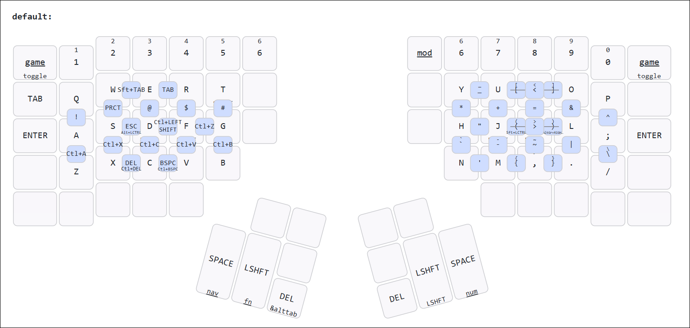
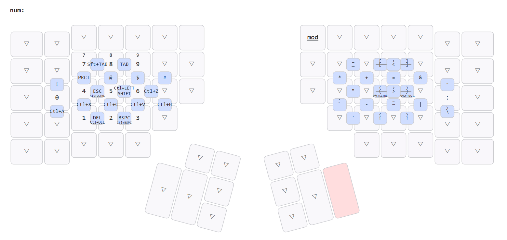
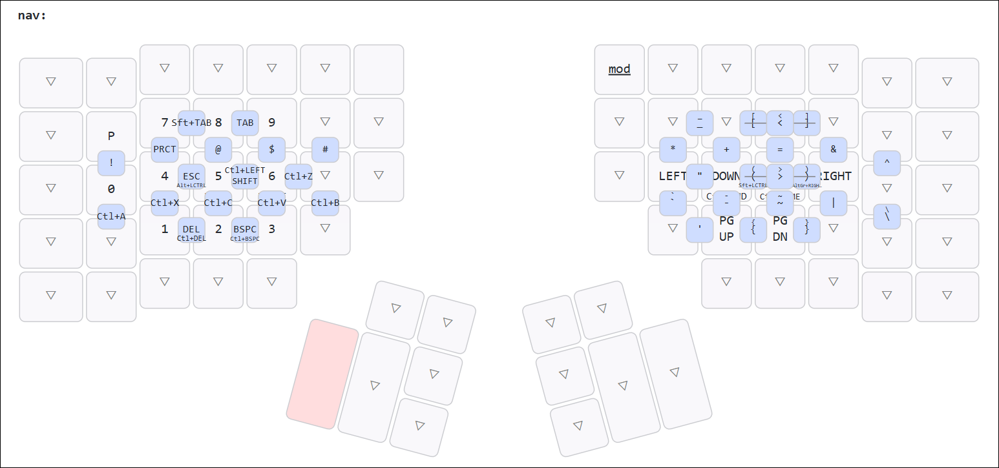

# Custom Kinesis Advantage 360 Pro configuration

This repository contains my custom ZMK keymap for the Kinesis Advantage 360 Pro. Use the interactive visualization to explore the layers, or follow the flashing steps to install the firmware.

## Keymap Visualization

**[View the interactive keymap](https://keymap-drawer.streamlit.app/?zmk_url=https%3A%2F%2Fgithub.com%2FGreg-T8%2FKinesis-Adv360Pro-ZMK%2Fblob%2Fmain%2Fconfig%2Fadv360.keymap)**

**Default layer with home row mods**

**Number layer**

**Navigation layer**

## Home Row Mods

The default layer assigns modifiers to home row keys on both hands. Tap a key to enter its letter. Hold it to activate its modifier.

**Left hand**

- `A`: GUI when held
- `S`: ALT when held
- `D`: CTRL when held
- `F`: SHIFT when held

**Right hand**

- `J`: SHIFT when held
- `K`: CTRL when held
- `L`: ALT when held
- `;`: GUI when held

**Timing**

- Tapping term: 280 ms
- Prior idle requirement: 170 ms on the left and 250 ms on the right
- Quick tap: 150 ms
- Hold trigger on release: enabled for smoother modifier combinations

## Flashing the Firmware

Follow the programming instructions on page 8 of the [Advantage 360 Pro Quick Start Guide](https://kinesis-ergo.com/wp-content/uploads/Advantage360-Professional-QSG-v8-25-22.pdf).

1. Extract the firmware from the GitHub Actions build artifact for a cloud build, or from the `firmware/` folder for a local build.
2. Connect the left side keyboard to USB.
3. Press Mod+macro1 to put the left side into bootloader mode. The keyboard appears as a USB drive.
4. Copy `left.uf2` to the USB drive. The keyboard disconnects when the copy finishes.
5. Unplug both keyboards and switch them off.
6. Turn on the left keyboard with its switch.
7. Connect the right keyboard to USB to power it on.
8. Press Mod+macro3 to put the right side into bootloader mode. The keyboard appears as a USB drive.
9. Copy `right.uf2` to the mounted drive.
10. Unplug the right keyboard and turn it back on.
